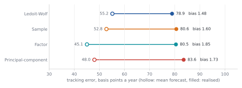
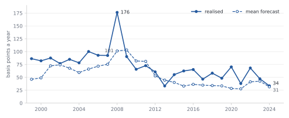
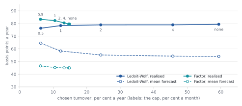
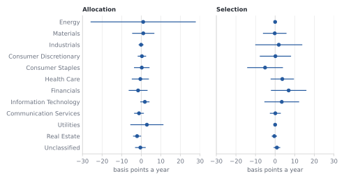

# Stock-level index tracking: a point-in-time benchmark, a long-only mandate, and its performance attribution by sector

The results are on the [dashboard](https://www.carlohofer.com/stock-level-tracking/dashboard/) and in the [note](https://www.carlohofer.com/stock-level-tracking/note/stock-level-tracking_note_2026-11.pdf).

I build a point-in-time S&P 500 universe from CRSP and Compustat and check it in three ways: against CRSP's own return, count and total value for the same universe, and against Ken French's portfolios formed on size and momentum and on size and variance. On that universe I then run a long-only mandate that holds close to the benchmark, under four covariance estimators from July 1999 to December 2024, split its turnover into the part that changes in index membership force, the part that follows the benchmark's own reweighting and the part the optimiser chooses, and attribute its active return by sector with the method of Brinson and Fachler (1985).

## Summary

- Under the mandate the four covariance estimators realise 78.9 to 83.6 basis points a year of tracking error, and each one's forecast understates it. The bias statistic, the standard deviation of the active return in units of each month's forecast, 1 for a calibrated forecast, is 1.48 to 1.85, above the band of 0.8 to 1.25 fixed before the run: the realised active return is 48 to 85 per cent more volatile than forecast.
- Index changes force 2.99 per cent a year of the Ledoit-Wolf path's 26.26 per cent of one-way turnover, or 11.4 per cent. Loosening the cap on chosen turnover from 0.5 per cent a month to none raises chosen turnover from 6.3 to 59.4 per cent a year on the Ledoit-Wolf estimator and from 6.2 to 14.9 on the factor estimator, and lowers the mean forecast on both. Neither estimator's realised tracking error moves by an amount the 306 months can tell from zero: plus 3.1 basis points a year on Ledoit-Wolf, with a paired 95 per cent interval of minus 3.6 to plus 9.8, and minus 3.7 on the factor estimator, from minus 18.9 to plus 11.4.
- Month by month, allocation is the largest of the three Brinson-Fachler terms on the Ledoit-Wolf, factor and principal-component estimators: 16.4 to 16.7 basis points a month in absolute value on average, against 10.6 to 13.8 for selection and 1.5 to 2.2 for interaction. Over the 306 months the active return is 0.2 to 13.7 basis points a year before costs, within one Newey-West standard error of zero on every path, as is each of its three terms, and the six factors explain 2 to 13 per cent of its variance.
- The benchmark rebuilt from CRSP's list of index members reproduces CRSP's own value-weighted return of the same list with a tracking error of 11.5 basis points a year from 1926 to 2024. Its momentum and variance spreads have correlations of 0.888 and 0.954 with Kenneth R. French's large-cap spreads.

## The data layer

The universe in month t is the set of stocks in CRSP's list of index members on the last trading day of month t minus 1, so that nothing unknown when the month begins decides membership. Each member's monthly return comes from CRSP's monthly stock file. A delisting in the month is applied by the study's rule, after Shumway (1997): CRSP's delisting return where it gives one, which compares the value after the delisting with the price on the last day of trading (CRSP, 2025, p. 30), and where it does not, minus 30 per cent for a delisting code from 400 to 599 and zero for any other code. CRSP names the codes beginning with 4 a liquidation and those beginning with 5 a delisting by the exchange (p. 28), and the study treats both as a delisting for poor performance. A member's market capitalisation at the start of month t is its price times its shares outstanding at the end of month t minus 1, with the absolute value of the average of bid and ask standing in for a missing closing price (pp. 70 and 100), and the benchmark weights each member by it. A member's sector is the GICS sector in force on the last trading day of month t minus 1, found through CRSP's link to Compustat. A member with no sector on that day is counted in a twelfth sector, Unclassified. The index as S&P publishes it is not the benchmark: its total return is not in the extraction, and since 2005 it weights each stock by its float, the shares available to the public. CRSP gives one share count per security and no float factor (pp. 79 and 80), so the index's float-adjusted weights cannot be rebuilt from it. CRSP ends on 31 December 2024 on this subscription, and so does the sample.

Two further comparisons have no verdict. Compustat's history of the index's members is set beside CRSP's list, by year. On this subscription that history lists the members of September 2026 alone, so the cross-check covers names still in the index and says nothing about removals. The benchmark's price-only return is also set beside the index's own price return, by period. Until 2005 the index weighted each stock by its full capitalisation, as the benchmark does, so a member missing from CRSP's list or a removal dated wrongly would widen the gap between the two, and the gap is evidence on membership independent of the list, removals included.

The evaluation window of the mandate runs from July 1999 to December 2024, 306 months, because Compustat's GICS history begins on 30 June 1999 and the mandate's sector constraints need a sector for every member. It holds only if in every one of those months at least 95 per cent of the universe's members and at least 95 per cent of its capitalisation have a sector, a condition fixed before the coverage was seen.

Notebooks 01 to 05 build each part from the extraction and run four gates and two expectations on it:

- **G1**: the benchmark's tracking error against CRSP's own value-weighted return of the same list is at most 50 basis points a year over the usable window.
- **G2**: the usable window is at least 15 years long.
- **G3**: at least 90 per cent of the stocks removed from the universe from 2 January 1990 to 31 December 2024 have a CRSP price within 10 trading days of their removal.
- **G4**: the market capitalisation is present in at least 90 per cent of membership months for at least 90 per cent of names.
- **E1**: the tracking error is at most 20 basis points a year and the mean monthly difference within 2 basis points of zero, with dividends and price-only.
- **E2**: the universe's count is within 10 names of CRSP's count in every month of the usable window, and its summed capitalisation within 2 per cent of CRSP's total value in at least 95 per cent of months.

## Results of the data layer

Notebooks 01 to 05 ran on 11 November 2026 on the extraction of 28 September 2026, with the GICS history added on 10 November 2026. Every figure below is in `results/20260928/`, and the six verdicts are in `verdicts_milestone1.json`. All four gates and both expectations are met.

- **The universe** holds 1,936 securities over 2,064 membership spells, 440,724 member-months from January 1926 to December 2024. Its count is within 10 names of CRSP's own count on the same day in all 1,188 months, so the usable window is the whole 99 years (G2).
- **The reconstruction.** The benchmark's tracking error against CRSP's value-weighted return of the same list is 11.5 basis points a year with dividends and 11.6 price-only, with mean monthly differences of minus 0.18 and minus 0.16 basis points (G1 and E1). Rebuilt on CRSP's own definition of its index, the members at the end of the month with a price at both of its ends, ADRs left out and no delisting return (CRSP, 2025, pp. 104 and 106), the return has a tracking error of 8.2 basis points a year against CRSP's with dividends and 8.2 price-only, and the benchmark one of 13.3 and 13.4 against it. So the difference of definition accounts for part of the benchmark's 11.5 basis points, and the rest has no cause the study can name. The three figures are tracking errors and do not subtract: the benchmark stands further from the rebuilt return than from CRSP's, so its difference from the rebuilt return and the rebuilt return's difference from CRSP's offset in part. CRSP's count of the stocks its return uses equals the rebuilt return's in 606 of the 1,188 months, and in 1,129 when the month's ADR is counted, one ADR in each of 544 months. This suggests that CRSP's count includes the ADR, and whether its return does is not tested. This comparison was added on 19 November 2026, after the study's results were known, and has no verdict. Over the evaluation window, July 1999 to December 2024, the tracking error with dividends is 15.2 basis points a year, with no verdict. Its summed capitalisation is within 2 per cent of CRSP's total value in 1,186 of the 1,188 months (E2).
- **Removals and capitalisations.** All 836 removals from 2 January 1990 have a CRSP price within 10 trading days (G3). Of the 725 removals before 1990, 658 have a price at the end of the removal month or the month before, reported with no verdict. 1,902 of 1,912 names have a market capitalisation in at least 90 per cent of their membership months (G4).
- **Delistings.** Of the 799 delisting months of members, CRSP gives the delisting return in 798, and the study's minus 30 per cent, after Shumway (1997), is used once. Of the 798, 6 are partial-month returns, which compare the last trading price with the last month-end price where CRSP has no information after the delisting, and which CRSP's guide calls not truly delisting returns (CRSP, 2025, pp. 30 and 98). Four of them fall in the 36 months with a code from 400 to 599. The study's rule applies CRSP's value as it stands, so no return changes.
- **The index's own price return**, with no verdict. The benchmark's price-only return differs from it by 145.8 basis points a year over 1926 to 1956, 36.0 over 1957 to 1989, 20.6 over 1990 to 1998 and 28.3 over 1999 to 2004, the years in which the index weighted by full capitalisation, and by 22.2 over 2005 to 2024, when it weights by float, each the tracking error pooled over the years of the period. From 1957 the gap lies between 20.6 and 36.0 in every period, and the move to float in 2005 leaves it in that range, 22.2 after it against 28.3 over the six years before. So from 1957 no period stands out, and the gap is no smaller in the years when the index weighted by full capitalisation than after 2005, when it weights by float. The comparison is therefore not fine enough to show the change of weighting, and it would show an error of membership only if the error moved the return by more than these 20 to 36 basis points a year. Before 1957, when the index holds 90 names (CRSP, 2025, p. 104), the gap is 145.8, with 372 in 1926 and 367 in 1927, so in those years the comparison does not confirm the list and cannot say whether the list or the index's own computation is the cause. CRSP's guide says that CRSP has no data for two securities of the index between 1925 and 1931 (p. 106), so in those years the benchmark lacks two of the 90 members, and the study does not measure what that adds to the gap. The 93.6 basis points of all the months to December 2004 come from the years before 1957: pooled over 1957 to 2004 the gap is 32.7.
- **Compustat's list.** Of the member-months of Compustat's 468 members that joined by December 2024, the universe holds at least 99.1 per cent in every year from 1990. Both lists date 339 of the 347 joins from 1990 to the same month.
- **Sectors.** A member takes its company's sector through any link of the two link types, so a second share class has its company's sector. From July 1999 to December 2024 at least 99.4 per cent of the universe's members and at least 99.0 per cent of its capitalisation have a GICS sector in every month, so the evaluation window runs the 306 months from July 1999. Every cell of the table of sector weights by month sums at least three securities, and none is more than 58.4 per cent of its cell.

## The answer key and the covariance estimators

Notebook 06 sorts the universe each month on two signals known at the start of the month and compares the result with Ken French's portfolios, which are built from the same CRSP files by other rules. Momentum is the return compounded from month t minus 12 to month t minus 2, and variance is the variance of daily returns over the 60 trading days before the month, both as French defines them and with his conditions for a stock to enter the sort, with one exception: a missing return between month t minus 12 and month t minus 3 is skipped here, where French's rule admits it only as a missing price, and 548 of the 436,862 member-months sorted on momentum are sorted with such a month. The members are cut into five groups of equal size, the quintiles, and the spread is the cap-weighted return of the highest quintile minus that of the lowest. French's spread is the same within his largest size quintile, the stocks above the 80th percentile of the market capitalisations of NYSE stocks. That quintile holds between about 100 and 530 names a month, fewer than the universe's 500 in almost every month from April 1957 and more than its 90 before, so the two sets overlap without coinciding.

Notebook 07 estimates, for each month of the evaluation window, the covariance matrix of the members' daily excess returns over the three years before the month in the four ways the mandate will use: the sample covariance, the Ledoit-Wolf estimator, which shrinks the sample covariance towards a scaled identity matrix (Ledoit and Wolf 2004), a factor model on French's five factors and his momentum factor, and a principal-component model with the benchmark as its first factor. The four are copied unchanged from the repository of Optimal versus naive diversification at commit 5414f14, and a test checks each copied file's SHA-256. A member that lacks a return on more than five days of the window, about 11 a month, takes a row from a model fitted on its own days, and each of the four matrices is built so that it is positive semi-definite by construction.

- **E3**: for the momentum sort and for the variance sort, the universe's spread has a correlation of at least 0.80 with French's, and their mean monthly difference is within two standard errors of zero.
- **E4, first clause**: in every month of the evaluation window, the condition number of the sample covariance matrix is at least 10 times that of the Ledoit-Wolf matrix. The second clause, on the mandate's tracking error, is judged in milestone 3.

## Results of milestone 2

Notebooks 06 and 07 ran on 12 November 2026 on the same extraction, with French's files built on CRSP's database of September 2026 and downloaded at run time. Every figure below is in `results/20260928/`, and the three verdicts are in `verdicts_milestone2.json`. E3 is met for both sorts. The first clause of E4 is not met.

- **Momentum** (E3 met). Over the 1,172 months from January 1927 to December 2024 with a value in both, the universe's spread has a correlation of 0.888 with French's, and their mean monthly difference is minus 10.4 basis points on a standard error of 9.0, or 1.15 standard errors. With no verdict, the correlation is 0.846 over the 359 months to March 1957, when the universe held about 90 names, and 0.927 over the 813 months from April 1957. With ten groups in place of five it is 0.875, and the mean difference plus 23.6 basis points on a standard error of 11.4.
- **Variance** (E3 met). Over the 417 months from April 1990, the correlation is 0.954 and the mean monthly difference plus 2.7 basis points on a standard error of 9.4, or 0.29 standard errors. With ten groups, with no verdict, 0.912 and plus 12.6 on 17.2.
- **The stocks left out of the sorts.** Of 439,656 member-months from January 1927, 2,539 have no price 13 months back, 103 have no return two months back and 152 have no capitalisation, and 548 are sorted with one month missing from the compounding. Of 209,020 member-months from April 1990, 76 have fewer than 20 daily returns and 9 have no capitalisation.
- **Conditioning** (E4's first clause not met). The sample matrix's condition number is at least 10 times the Ledoit-Wolf matrix's in 86 of the 306 months, all of them from 2017. The ratio is 5.4 at the median and 2.8 at the least, in August 2012. With about 490 members on about 755 days the sample matrix is not singular, and the Ledoit-Wolf shrinkage intensity lies between 1.1 and 7.1 per cent, so the shrunk matrix stays close to the sample one. The ratio is above 10 in every month from 2018 to 2022, and the sample matrix's condition number is highest in 2020, 381,000 at the median against 5,000 for the Ledoit-Wolf matrix. The months that reach the level have another cause. From 2014 the universe holds up to five companies with two share classes each. Where both classes of a company are complete members, their daily returns have a correlation of 0.98 at the median, so the difference between the two is a portfolio with almost no variance, and it sets the smallest eigenvalue of the sample matrix. With one share class for each company the level is reached in 30 of the 306 months, all from 2020 to 2022, and the median ratio is 5.0. This check was added after the run and carries no verdict.
- **Members without a complete window.** A month has 490 complete members on average and 478 at the least, and 11.4 members with a row from a model on average and 22 at the most, of whom 3.2 on average had fewer than 252 daily returns. 190 member-months in 134 months had fewer than 60 and took the mean loadings of their sector's complete members, or of the whole universe's. At most 9 days were left out of a window. Every matrix passed the eigenvalue check in every month.

## The mandate and the rolling evaluation

The mandate holds the universe close to the benchmark under constraints a long-only client would set. Each month it chooses the weights that make the forecast tracking error, the tracking error the month's covariance matrix implies for the active weights, as small as the constraints allow. The constraints come in four cumulative sets. C0 is long-only. C1 adds a bound per stock, each within 50 basis points of its benchmark weight, the same bound on the sum of a company's share classes, and a band per GICS sector, each within 2 percentage points of its benchmark weight. C2 adds a cap of 2 per cent a month on chosen turnover, measured from the reference portfolio, so that forced turnover lies outside the cap. C3, the mandate, adds the tilt, a weight of zero in two GICS sub-industries, Tobacco and Aerospace and Defense, and a beta of one to the benchmark. A sub-industry is wider than a list of controversial weapons. In a set with the tilt the sector band applies to the other sectors only, because half of Energy's benchmark weight is above 2 percentage points in 268 of the 306 months. In the same way the bounds per stock and per company cover the stocks outside the tilted sectors and the excluded sub-industries: a tilted stock is held between zero and half its benchmark weight, and an excluded one at zero. No largest active weight is published for the paths under the mandate, because there it is one stock's weight. The optimiser is copied unchanged from the repository of Optimal versus naive diversification, and `src/slt/mandate.py` adds the bound per company and the sector bands from its own pieces. A test requires both to give the same weights on that repository's own constraint sets.

The script `scripts/run_evaluation.py` runs 24 paths month by month over the evaluation window, each starting as the benchmark: the four estimators under the four sets at the 2 per cent cap, and the Ledoit-Wolf and factor estimators under the mandate at caps of 0.5, 1 and 4 per cent and with no cap, which trace the frontier of tracking error against turnover. Costs are 10 basis points per unit of total one-way turnover, forced turnover included, with 20 as the sensitivity. Each month's turnover is split into forced turnover, reweighting and rebalancing, each measured, and their overlap.

- **E4, second clause**: under the mandate at the 2 per cent cap, the sample estimator's realised tracking error is above the Ledoit-Wolf estimator's.
- **E5**: for the Ledoit-Wolf and the factor estimators, the mean forecast tracking error does not rise as the cap loosens across the five caps, and the realised tracking error at the 4 per cent cap is below that at 0.5 per cent.
- **E6**: under the mandate at the 2 per cent cap, the realised tracking error of the Ledoit-Wolf, factor and principal-component estimators each lies between 50 and 150 basis points a year, and each one's bias statistic between 0.8 and 1.25.
- **E7**: under the mandate at the 2 per cent cap on the Ledoit-Wolf estimator, forced turnover is less than a third of total one-way turnover over the window.

## Results of milestone 3

The constants of milestone 3 were committed on 12 November 2026 at 15:42, Amsterdam time, and the script ran on the same extraction from 15:42 to 16:04, with cvxpy 1.7.5, Clarabel 0.11.1 and NumPy 2.0.2 on two threads of linear algebra in each of four processes. Every figure below is in `results/20260928/`, and the four verdicts are in `verdicts_milestone3.json`. E4's second clause and E7 are met. E5 is not met: it holds for the factor estimator and fails for the Ledoit-Wolf estimator. E6 is not met for any of the three estimators.

- **C0, C1 and C2.** Nothing in these sets pushes the portfolio off the benchmark, and it stays there in every month. The largest absolute active weight in any month of the twelve paths is 2.4e-6, and only the sample estimator's paths ever differ from the benchmark by more than one millionth: in 11 months under C0 and in 1 under C1. The 2 per cent cap never binds under C2. A path that holds the benchmark turns over 5.78 per cent a year: forced turnover 2.80, reweighting 3.71, rebalancing zero and an overlap of 0.73 to 0.74. The benchmark alone, counting the change from June to July 1999, turns over 5.82 per cent a year: forced turnover 2.84, reweighting 3.73 and an overlap of 0.75.
- **The mandate at the 2 per cent cap.** The realised tracking error is 78.9 basis points a year on the Ledoit-Wolf estimator, 80.6 on the sample estimator, 80.5 on the factor estimator and 83.6 on the principal-component estimator. The mean forecast is 55.2, 52.8, 45.1 and 48.0. The mean active return is 12.7, 13.7, 8.7 and 0.2 basis points a year gross of costs, each within one Newey-West standard error of zero (17.4 to 18.6), and 10.1, 11.1, 7.1 and minus 1.7 net of costs at 10 basis points. On the Ledoit-Wolf estimator the cap binds in every month, the portfolio holds 388 names on average and 333 at the least, and the realised tracking error by year runs from 33 basis points in 2013 to 176 in 2008, when the forecast was 101, and is 34 in 2024.
- **E4, second clause** (met). The sample estimator's realised tracking error, 80.6 basis points a year, is above the Ledoit-Wolf estimator's, 78.9. The two paths share their 306 months and their active returns have a correlation of 0.996, so the difference is tested on the paired months (notebook 13): 1.7 basis points a year, with a 95 per cent interval of 0.8 to 2.6 (p 0.003, and 0.009 with Holm's correction across the three estimators set against Ledoit-Wolf). The difference is small and distinguishable from zero. Corrected on 18 November 2026: this line had said the difference was smaller than the sampling error of either figure, about 3, which is the standard error of one tracking error and not of the difference between two measured on the same months.
- **E5** (not met). For both, the mean forecast tracking error falls as the cap loosens: from 64.5 basis points a year at 0.5 per cent to 54.1 with no cap on the Ledoit-Wolf estimator, and from 46.6 to 45.0 on the factor estimator. The realised tracking error at the 4 per cent cap is 79.6 on the factor estimator, below its 83.3 at 0.5 per cent, and 79.0 on the Ledoit-Wolf estimator, above its 76.3 at 0.5 per cent. On the paired months (notebook 13) neither change can be told from zero: minus 3.7 basis points a year on the factor estimator, with a 95 per cent interval of minus 18.8 to plus 11.4 (p 0.32), and plus 2.7 on the Ledoit-Wolf estimator, from minus 3.2 to plus 8.6 (p 0.33), where the two comparisons could detect a change of 17.2 and 8.0 four times in five. From 0.5 per cent to no cap the changes are minus 3.7 (minus 18.9 to plus 11.4) and plus 3.1 (minus 3.6 to plus 9.8). The factor estimator's 79.6 against 83.3 comes from two months of 2008, July and December, which carry 97 per cent of the difference between the two variances: without them the change is minus 0.1, with an interval of minus 2.3 to plus 2.1 and a critical value of 2.1. E5's second part compares the two point estimates, as it was fixed before the run, and its verdict stands on them. E5 has one verdict because an expectation named for two or more estimators is met only if it holds for each, a rule set on 12 November 2026 after the run: before it, E5 read met for the factor estimator and not met for the Ledoit-Wolf estimator. Across the five caps the Ledoit-Wolf estimator's chosen turnover runs from 6.3 to 59.4 per cent a year, and its realised tracking error lies between 76.3 and 79.4. In a month where the other constraints need more chosen turnover than the cap allows, the cap gives way to the least turnover they need. This happens in the first month of every capped path under the mandate, July 1999, when the portfolio leaves the benchmark for the mandate and needs 6.41 per cent, and in 6 further months at the 0.5 per cent cap on the Ledoit-Wolf estimator and 3 on the factor estimator. So on the Ledoit-Wolf estimator at caps of 0.5, 1 and 2 per cent, where the cap binds in every month, chosen turnover a year lies a little above twelve times the cap.
- **E6** (not met). The realised tracking error lies inside the range of 50 to 150 basis points a year for all three estimators, at 78.9, 80.5 and 83.6. The bias statistic, over all 306 months, is 1.48 on the Ledoit-Wolf estimator, 1.85 on the factor estimator and 1.73 on the principal-component estimator, above the band's upper end of 1.25 for all three: every estimator's forecast understates the mandate's realised tracking error. A circular block bootstrap of the months, in blocks of 12 and with 2,000 samples, added on 19 November 2026, after the study's results were known, gives each bias statistic a 95 per cent interval: 1.29 to 1.67 on the Ledoit-Wolf estimator, 1.63 to 2.08 on the factor estimator and 1.51 to 1.91 on the principal-component estimator, each wholly above 1.25. On the Ledoit-Wolf path at the 0.5 per cent cap the bias statistic is 1.26, and its interval of 1.08 to 1.45 reaches into the band, so the 306 months cannot tell that path's forecast from one inside the band.
- **E7** (met). Under the mandate at the 2 per cent cap on the Ledoit-Wolf estimator, forced turnover is 2.99 per cent a year of a total of 26.26, or 11.4 per cent. Reweighting is 3.67, rebalancing 24.94 and the overlap 5.34.
- **The table by month.** Every one of the 3,672 cells of active returns of the twelve paths under the mandate passes the rule for a signed sum, so none is left empty. No company's share classes differ in sector or in the bound's scope in any month, and every problem was solved to the solver's optimum.

*Figure 1. Forecast (hollow) and realised (filled) tracking error under the mandate at the 2 per cent cap, with the bias statistic, July 1999 to December 2024. Every realised value lies to the right of its forecast. The bias statistic is the standard deviation of the active return in units of each month's forecast, and not the ratio of the two points, which is 1.43 to 1.79.*

*Figure 2. Realised and mean forecast tracking error by calendar year, the Ledoit-Wolf estimator under the mandate, 1999 to 2024, with 1999 holding six months. The realised tracking error is above the mean forecast in 22 of the 26 years, and not in 2009, 2010, 2011 and 2013.*

*Figure 3. Realised (filled) and mean forecast (hollow) tracking error against chosen turnover at caps of 0.5, 1, 2 and 4 per cent a month and with no cap, the Ledoit-Wolf and factor estimators under the mandate, July 1999 to December 2024.*

## The attribution

Notebook 11 splits the active return of the mandate's four paths at the 2 per cent cap two ways. By sector, with the method of Brinson and Fachler (1985): in each month and for each of the twelve sectors, allocation is the sector's active weight times the benchmark sector's return less the benchmark's, selection is the sector's benchmark weight times the portfolio sector's return less the benchmark sector's, and interaction is the sector's active weight times that same difference. Summed over the sectors, the three equal the month's active return. Both sides are taken over the month's names with a return, each rescaled to one, as the committed active return is. A sector that the portfolio does not hold, none of its stocks above a weight of one millionth, has a selection of zero and keeps the rest of its part as interaction. Unclassified holds one to three securities a month. The monthly terms are summed over months arithmetically, with no geometric linking. By factor, with the factor attribution of the repository of Optimal versus naive diversification, copied unchanged: each month's active exposures to the five factors of Fama and French (2015) and momentum, from each member's loadings in the factor estimator, times French's monthly factor returns, with a residual that closes the sum.

- **E8**: the three terms sum to the active return within 1e-9 in every month of the four paths, and on each of the Ledoit-Wolf, factor and principal-component paths the mean absolute monthly allocation exceeds the mean absolute monthly selection, with the interaction's the smallest of the three, each month's figure being the sum over the twelve sectors.
- **E9**: contributions and residual sum to the active return within 1e-9 in every month, and the mean active exposure to the market factor is within 0.05 of zero on each of the four paths.

## Results of the attribution

Notebook 11 ran on 17 November 2026 after its constants were committed, and again the same day to count how often the tilt's cap binds, in `tilt_cap.csv`. Every figure below is in `results/20260928/`, and both verdicts are in `verdicts_milestone4.json`. E8 and E9 are met.

- **E8** (met). The largest gap between the sum of the three terms and the active return, in any month of the four paths, is 9.6e-17. The mean absolute monthly allocation, selection and interaction are 16.6, 13.8 and 1.8 basis points on the Ledoit-Wolf path, 16.7, 10.6 and 1.5 on the factor path and 16.4, 12.3 and 2.2 on the principal-component path. With no verdict, they are 16.6, 14.4 and 1.9 on the sample estimator's path. Summed over the two tilted sectors alone, the mean absolute monthly allocation is 15.7 basis points on the Ledoit-Wolf path, against 4.4 over the other ten sectors, and the tilted sectors' figure is the larger on all four paths. The two do not add to the 16.6 over all twelve, because allocations of opposite sign in the same month offset. These figures were added on 19 November 2026, after the study's results were known.
- **The terms over the window.** On the Ledoit-Wolf path the active return of 12.7 basis points a year splits into allocation 1.4, selection 11.3 and interaction 0.0, with Newey-West standard errors of 15.9, 14.0 and 2.0, so none is distinguishable from zero. Allocation is 1.3, 5.5 and 3.5 on the sample, factor and principal-component paths, and selection 12.3, 4.0 and minus 3.9. On all four paths, selection in Energy and Utilities, the two tilted sectors, is within a tenth of a basis point a year of zero. A sector whose stocks are all held at the same fraction of their benchmark weights earns the benchmark sector's return, and the tilt caps each stock at half its benchmark weight. The cap binds on almost every stock. Of the 19,433 stock-months in the two sectors, the stock sits at half its benchmark weight, within one millionth, in 19,431 on the sample and Ledoit-Wolf paths, in all 19,433 on the factor path and in 19,263 on the principal-component path, where the other 170 sit below. So selection there is close to zero, and not zero. Their allocation on the Ledoit-Wolf path is 1.0 and 2.9 basis points a year, on standard errors of 13.4 and 4.2.
- **E9** (met). Contributions and residual sum to the active return within 8.7e-19 in every month. The mean active exposure to the market factor is minus 0.0006 on the sample and Ledoit-Wolf paths, plus 0.0001 on the factor path and minus 0.0002 on the principal-component path. The six factors explain 9 per cent of the variance of the active return on the Ledoit-Wolf path, and 2 to 13 per cent on the other three. On the Ledoit-Wolf path their contributions sum to minus 9.7 basis points a year and the residual to 22.4. The copied attribution gives plain standard errors, with no allowance for correlation from one month to the next: 4.4 and 14.9. With Newey-West standard errors at 12 lags in their place, added on 19 November 2026, after the study's results were known, the six-factor total of minus 9.7 basis points a year, on a standard error of 7.7, is not two standard errors or more from zero, and the market term of minus 1.7, on 0.6, is. Three of the 24 factor contributions of the four paths lie two Newey-West standard errors or more from zero, all three the market term. The four paths carry the same tilt, so the three are not three separate results, and among 24 unrelated figures about one would lie that far from zero by chance.
- **The counts.** 66 member-months have no return and are left out of both sides. A sector is not held in 22 months on the sample estimator's path and in 16 on the Ledoit-Wolf path, all from 2022, and never on the factor and principal-component paths.

*Figure 4. Allocation and selection by sector over the window as annual averages, each with a bar of two Newey-West standard errors on each side, the Ledoit-Wolf path under the mandate at the 2 per cent cap, July 1999 to December 2024. On this path 3 of the 36 sector terms, interaction included, which the figure does not show, lie two standard errors or more from zero, and 1 to 4 on the other paths, against, at the 5 per cent level, 1.8 on average if the tests were independent.*

## The paired tests

Notebook 13 was added on 18 November 2026, after every recorded run, and changes no verdict. Two paths under the mandate share their 306 months and their active returns move together, so the difference between their realised tracking errors is tested on the paired months, with the variance test of Ledoit and Wolf (2011) copied unchanged from the repository of Optimal versus naive diversification at commit 0e651a0. A circular block bootstrap of the months, in blocks of 12 and with 2,000 samples, gives each difference a 95 per cent interval and a p-value, and beside them the difference the comparison could detect four times in five. The notebook reads the committed active returns and needs no extraction. Family A sets the sample, factor and principal-component estimators each against Ledoit-Wolf under the mandate at the 2 per cent cap, with Holm's correction across the three. Family B sets, on the Ledoit-Wolf and factor estimators, the 4 per cent cap and no cap each against the 0.5 per cent cap. The seven rows are in `paired_tests.csv`, and the test's size in `paired_size_check.csv`.

- **P1** (met). Before the test touched the study's returns, it rejected at the 5 per cent level 2.3 per cent of 1,000 simulated pairs of 306 months with equal variances at a correlation of 0.99, and 3.3 per cent at a correlation of 0.80, against at most 6.5 per cent. The test is therefore conservative on 306 months.
- **Family A.** The sample estimator's realised tracking error less the Ledoit-Wolf estimator's is plus 1.7 basis points a year, with a 95 per cent interval of 0.8 to 2.6 (Holm p 0.009), the factor estimator's plus 1.5 (minus 5.9 to plus 9.0, Holm p 0.65) and the principal-component estimator's plus 4.6 (minus 3.7 to plus 13.0, Holm p 0.48). Only the first is distinguishable from zero, and the other two comparisons could detect a difference of 10.1 and 11.5 basis points four times in five.
- **Family B.** The changes along the frontier are under E5 above. Their intervals all include zero. On the factor estimator the bootstrap's critical value is 5.9, against 2.2 to 2.4 on the other five rows, so those two intervals are wide. Two months of 2008, July and December, carry 97 and 99 per cent of the difference between the two variances at the 4 per cent cap and with no cap, each against the 0.5 per cent cap. Without them the change is minus 0.1 basis points a year at the 4 per cent cap, with an interval of minus 2.3 to plus 2.1 and a critical value of 2.1, and 0.0 with no cap, from minus 2.1 to plus 2.1, in `paired_tests_without_two_months.csv`.

## What is pre-committed

Every gate, expectation, sample boundary and mandate level is in `src/slt/constants.py`, one per line with its reason and the date it was fixed. The 25 levels of the gates and expectations are in the repository's first commit, of 10 November 2026, before any code that judges them ran, and are unchanged since. Rules for reading them that came later are dated there: the window of G4, fixed on 11 November 2026 and committed with milestone 1's results, three rules committed with milestone 2's results on 12 November 2026, the matrices on which E4's first clause is read, the standard error of E3 and the columns of French's largest size quintile, and the rule that an expectation named for two or more estimators has one verdict, set on 12 November 2026 after the run of milestone 3. The paired tests of notebook 13 were added on 18 November 2026, after every recorded run, with no verdict on the study's results. A gate that is not met stops the study, and the data layer is then published alone with the reason. An expectation that is not met is reported as a finding, in the same words as one that is met.

## Data

The stock data are CRSP and Compustat, via Wharton Research Data Services, accessed through Queen Mary University of London, from an extraction of 28 September 2026. They are licensed, and this repository holds none of them: it holds code, tests, the SHA-256 of the extraction's manifest and aggregate results. Nothing that reproduces CRSP's index file is committed by month, so the benchmark's return, the universe's count and its summed capitalisation appear only in summaries and by year. Four tables are committed by month, from July 1999 to December 2024: the eleven GICS sector weights as shares of the classified capitalisation, the active returns of the twelve paths under the mandate, gross of costs, their forecast tracking errors, each cell empty where the active return's is, and the 19 path-months in which the turnover cap gave way, with the path, the cap and the month's chosen turnover. Nothing of the attribution is committed by month, and no sector weight of the portfolio in any form. A sector weight by month is committed only if it sums at least three securities and no security is more than 80 per cent of it, so the Unclassified sector is never committed by month. An active return by month is committed only if at least three stocks hold an active weight above one millionth and no stock's absolute contribution is more than 80 per cent of the sum of the absolute contributions, and a cell that fails is left empty and counted. No portfolio weight of any security is committed. Ken French's data library is downloaded at run time and is not committed either. The descriptions of the fields of CRSP's stock and index files in this repository follow CRSP's guide to its stock and index databases (CRSP, 2025), read on 19 November 2026 and cited by printed page. CRSP's list of index members and its link to Compustat are not in the guide, and are described from the study's design and from counts of the extraction. The guide names none of the tables of Wharton Research Data Services: `crsp.msp500` is read as its CRSP Value-Weighted Index of the S&P 500 Universe, index 1000500, with the published S&P 500 Composite, index 1000502, beside it (p. 112).

## How to run it

1. Obtain the extraction. Each file's query and SHA-256 are in `results/20260928/extraction_files.csv`. CRSP corrects its history with each release of its data, as errors are identified (CRSP, 2025, p. 5), so the same queries run later can return other files, with other hashes.
2. Set the environment variable `SLT_DATA_ROOT` to the folder that holds the extraction's `manifest.json`, outside the repository. Notebook 01 stops with one sentence when the manifest's SHA-256 differs from `MANIFEST_SHA256` in `src/slt/constants.py`.
3. Install the requirements with `pip install -r requirements.txt` and run the notebooks in `notebooks/` in order, from 01. Each writes its aggregates to `results/20260928/`. Notebooks 06 and 07 download four files from Ken French's data library into `data/french/`, which git ignores, and notebook 11 two more, and each file's SHA-256 is recorded in `provenance_french.json`. The time recorded there is the time the run read the file, and `fetched_this_run` says whether the run fetched it then or read it from `data/french/`. After notebook 08, run `python scripts/run_evaluation.py`, which runs the 24 paths in four processes, one for each covariance estimator, and writes each path's records by month to `outputs/evaluation/`, which git ignores. A run that stops resumes from the last month written when the same command runs again. Notebooks 09 to 11 read those records and write the aggregates, and notebook 11 downloads French's monthly files of the five factors and of momentum.
4. Run notebooks 12 and 13, which read only the committed tables: notebook 12 draws the four figures into `dashboard/figures/`, and notebook 13 runs the paired tests in about two minutes. Then `python dashboard/build_dashboard.py` builds the dashboard and `python note/build_note.py` the note from the same tables. The note's PDF is printed by Chromium through Playwright, and pypdf writes its author into it: the three are not in `requirements.txt`, and `python note/build_note.py --no-pdf` writes the note's HTML alone.
5. Run `python -m pytest tests`. Beside the unit tests, the reconstruction test reads every file in `results/` and fails if one names a security, carries a series of CRSP's index file or holds more rows than an aggregate needs. On a machine with the extraction it also fails if a column by month equals a field of CRSP's index file, to the sixth decimal, in more than 5 per cent of months. The tests also check that the files copied from the repository of Optimal versus naive diversification are unchanged, and, where a clone of that repository sits beside this one, that the constants they read equal its own at commit 5414f14.

The notebooks are built by `build_notebooks.py` and committed without outputs.

## References

Brinson, G. P. and Fachler, N. (1985). Measuring non-U.S. equity portfolio performance. *Journal of Portfolio Management* 11(3), 73 to 76.

Fama, E. F. and French, K. R. (2015). A five-factor asset pricing model. *Journal of Financial Economics* 116(1), 1 to 22.

Holm, S. (1979). A simple sequentially rejective multiple test procedure. *Scandinavian Journal of Statistics* 6(2), 65 to 70.

Ledoit, O. and Wolf, M. (2004). A well-conditioned estimator for large-dimensional covariance matrices. *Journal of Multivariate Analysis* 88(2), 365 to 411.

Ledoit, O. and Wolf, M. (2011). Robust performance hypothesis testing with the variance. *Wilmott Magazine*, September 2011, 86 to 89.

CRSP (2025). *Data Descriptions Guide for CRSPAccess (FIZ) US Stock & Index Databases*. Center for Research in Security Prices, last modified 20 November 2025.

Shumway, T. (1997). The delisting bias in CRSP data. *Journal of Finance* 52(1), 327 to 340.

## Terms

- **universe**: the point-in-time S&P 500, that is, the stocks in CRSP's list of index members on the last trading day of the month before.
- **benchmark**: the cap-weighted universe, in which each stock's weight is its market capitalisation at the start of the month divided by the universe's total.
- **data layer**: the universe with its returns, delisting returns, market capitalisations and sectors, together with the checks run on it before the study uses it.
- **usable window**: the months from the first month in which the universe's count is within 10 names of CRSP's own count, to December 2024, the last month of CRSP on this subscription.
- **delisting return**: the return from a stock's price on its last day of trading to its value after the delisting, an off-exchange price or the payments to its holders (CRSP, 2025, p. 30).
- **GICS**: the Global Industry Classification Standard of S&P and MSCI, with 11 sectors and, below them, industry groups, industries and sub-industries.
- **Unclassified**: the twelfth sector, holding every member-month with no GICS sector on the day membership is read.
- **quintile**: one of five groups of equal numbers of stocks, ranked on a signal. A **spread** is the cap-weighted return of the highest quintile minus that of the lowest.
- **excess return**: a return minus the risk-free rate, here French's one-month Treasury bill rate.
- **covariance matrix**: the table of the variances of the stocks' returns and of their covariances with each other.
- **eigenvalue**: the variance of one of the uncorrelated portfolios into which a covariance matrix can be split. A matrix is **singular** when its smallest eigenvalue is zero, and **positive semi-definite** when none is negative.
- **condition number**: a covariance matrix's largest eigenvalue divided by its smallest. A large one means small errors in the matrix become large errors in the weights an optimiser draws from it.
- **shrinkage intensity**: the weight, from zero to one, that the Ledoit-Wolf estimator puts on its scaled identity matrix.
- **complete member**: a member with a return on every day of the three-year window but at most five. Every other member takes a row from a model fitted on its own days.
- **gate**: a test of the data layer fixed in advance. A gate that is not met stops the study.
- **expectation**: a test of a result fixed in advance. An expectation that is not met is reported as a finding.
- **active return**: the portfolio's return minus the benchmark's in the same month.
- **tracking error**: the standard deviation of the monthly active return, times the square root of 12.
- **mandate**: the full set of constraints the portfolio obeys. It is long-only, holds each stock and each company outside the tilted sectors and the excluded sub-industries within 50 basis points of its benchmark weight and each untilted sector within 2 percentage points, holds each Energy and Utilities stock between zero and half its benchmark weight and each stock of the two excluded sub-industries at zero, caps chosen turnover and keeps a beta of one to the benchmark.
- **tilt**: Energy and Utilities stocks held at no more than half their benchmark weight.
- **forced turnover**: the trading that changes in index membership require, selling a stock that leaves and buying one that enters.
- **chosen turnover**: all other trading, which the optimiser chooses and the turnover cap limits.
- **reference portfolio**: last month's portfolio after last month's returns, with the stocks that left the universe sold, the entrants bought at their benchmark weight and the others rescaled to sum to one. Forced turnover runs to it, and chosen turnover from it.
- **reweighting**: the turnover from the reference portfolio to last month's weights restored relative to the benchmark, each continuing stock at last month's weight times the ratio of its benchmark weights this month and last. It follows the benchmark's own changes in share counts, and its dividends.
- **rebalancing**: the turnover from last month's weights restored relative to the benchmark to the new weights, the optimiser's own moves. It is zero for a portfolio that holds the benchmark.
- **overlap**: forced turnover, reweighting and rebalancing less the month's total turnover, the trades of one step that the next undoes. It is never below zero.
- **path**: one covariance estimator under one constraint set at one turnover cap, run month by month over the evaluation window from the benchmark.
- **paired test**: a test of the difference between two figures measured on the same months, here the variance test of Ledoit and Wolf (2011) of two realised tracking errors. Its **95 per cent interval** comes from a circular block bootstrap, which takes new samples of 306 months from the months in blocks of 12 consecutive months. A difference whose interval excludes zero is distinguishable from zero at that level. Its **p-value**, written p, is the probability from the same bootstrap of a difference at least as far from zero if the two variances were equal. The **detectable difference** is the difference at which the interval would exclude zero four times in five.
- **Holm's correction**: an adjustment of the p-values of a family of comparisons for their number, the smallest multiplied by the family's size, the next by one less, each at least the one before it.
- **bias statistic**: the standard deviation of each month's active return divided by that month's forecast tracking error, over the months with a forecast above one millionth a year, the standard deviation of the active return in units of each month's forecast. It is one when the forecasts are right on average. It is not the realised tracking error divided by the mean forecast.
- **allocation**, **selection** and **interaction**: the three parts of the active return in the Brinson-Fachler attribution. Allocation comes from holding sectors at weights other than the benchmark's, selection from returns within a sector that differ from the benchmark's, and interaction from the two together.
- **active exposure**: a portfolio's loadings on a factor less the benchmark's, the members' loadings weighted by the active weights. A factor's **contribution** in a month is its active exposure times its return, and the **residual** is the active return less the contributions.

## Other projects

**Optimal versus naive diversification.** Under an index-tracking mandate on French's 49 industries, five covariance estimators understate their own tracking error, by 22 to 61 per cent. The replication of DeMiguel, Garlappi and Uppal (2009) reproduces 29 of the 30 Sharpe ratios that carry a band. [Page](https://www.carlohofer.com/projects/optimal-vs-naive-diversification/), [dashboard](https://www.carlohofer.com/optimal-vs-naive-diversification/dashboard/B-P_dashboard.html), [note](https://www.carlohofer.com/optimal-vs-naive-diversification/note/B-P_note_2026-10.pdf), [code](https://github.com/ochofer/optimal-vs-naive-diversification)

**Climate risk as an equity signal.** An ownership graph linking 328 listed companies to the 5,115 tracked assets they own. Of 19 apparent ownership changes checked by hand, 12 had no transaction behind them. [Page](https://www.carlohofer.com/projects/climate-risk-equity-signal/), [note](https://github.com/ochofer/paper1-hazard-exposure-data/releases/download/note-v1.2/what-a-vintage-difference-measures.pdf), [code](https://github.com/ochofer/paper1-hazard-exposure-data)

**Volatility-managed portfolios: a replication, the real-time critique, and the months after the sample.** Volatility estimation and position sizing on Ken French's equity factors, backtested out of sample and without look-ahead, replicating Moreira and Muir (2017) and Cederburg, O'Doherty, Wang and Yan (2020). Scaled by the inverse of last month's realised variance, a factor has a Sharpe ratio above the original's beyond its 95 per cent interval for one of six factors, momentum, and the 136 months after Moreira and Muir's sample cannot tell any difference from zero. [Page](https://www.carlohofer.com/projects/volatility-managed-portfolios/), [dashboard](https://www.carlohofer.com/volatility-managed-portfolios/dashboard/B-Q_dashboard.html), [note](https://www.carlohofer.com/volatility-managed-portfolios/note/B-Q_note_2026-11.pdf), [code](https://github.com/ochofer/volatility-managed-portfolios)

**Rules-based portfolio.** Runs a real-money portfolio under rules published before the first order: two UCITS ETFs at 70/30, a monthly cycle with pre-trade checks, look-through exposure and ex-ante risk on a public dashboard. [Page](https://www.carlohofer.com/projects/rules-based-portfolio/), [dashboard](https://www.carlohofer.com/rules-based-portfolio/), [guide](https://www.carlohofer.com/rules-based-portfolio/guide/guide.pdf), [code](https://github.com/ochofer/rules-based-portfolio)
